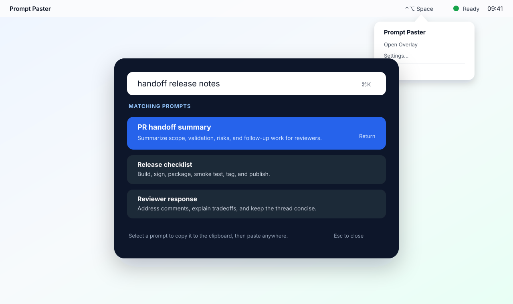

# Prompt Paster

[](https://github.com/prompt-paster/prompt-paster/releases/latest)
[](https://github.com/prompt-paster/prompt-paster/releases/latest/download/PromptPaster.dmg)
[](https://prompt-paster.github.io/prompt-paster/)
[](LICENSE)

Prompt Paster is a native macOS utility for quickly selecting reusable coding
agent prompts from an overlay and copying them to the clipboard.

Created by [Shay Palachy Affek](http://www.shaypalachy.com/).



**Website:** [prompt-paster.github.io/prompt-paster](https://prompt-paster.github.io/prompt-paster/) · **Download:** [latest DMG](https://github.com/prompt-paster/prompt-paster/releases/latest/download/PromptPaster.dmg)

## Current Status

The v0.2.0 download targets Apple silicon on macOS 14 or newer and is signed
with Developer ID and notarized by Apple.

The repository currently contains a native menu-bar utility with the core v1
selection loop:

- a SwiftPM macOS executable target
- a menu-bar utility app with no Dock icon
- local prompt storage seeded into Application Support
- a searchable overlay with keyboard and pointer selection
- clipboard copy-and-close behavior
- configurable fallback global hotkey, defaulting to `Control+Option+Space`
- configurable double-modifier trigger support, defaulting to double-Control
- settings and launch-at-login wiring
- GitHub Markdown/text prompt sources with Keychain-held credentials
- an optional starred-prompt home screen with editable order and letter keys
- local composite prompts that concatenate local and GitHub-backed prompts
- local `.app` and DMG release packaging

Auto-paste is intentionally out of scope for v1. Selecting a prompt copies the
prompt body to the clipboard, then the user pastes into the target app.

## Run Locally

Requirements:

- macOS
- Xcode command line tools or Xcode
- Swift 6.0 or newer

Run the app from the repository root:

```bash
swift run PromptPaster
```

The app appears in the macOS menu bar. Use the menu-bar item, configured
fallback hotkey, or configured double-modifier trigger to open the prompt
overlay.

## Build an App Bundle

To build a local `.app` bundle:

```bash
scripts/build-app.sh
```

The script creates:

```text
dist/Prompt Paster.app
```

The bundle uses `LSUIElement`, so it behaves as a hidden menu-bar utility rather
than a normal Dock app.

The app icon is checked in at `Packaging/PromptPaster.icns`. To regenerate it
from the local vector drawing helper:

```bash
scripts/generate-app-icon.sh Packaging/PromptPaster.icns
```

## Build an Installable DMG

The first release packaging artifact is a DMG. That matches the normal macOS
drag-to-Applications install flow while keeping the local release path small and
repeatable. ZIP packaging can be added later if GitHub release distribution
needs it.

Build and validate the DMG:

```bash
scripts/build-dmg.sh
```

The script creates:

```text
dist/PromptPaster-0.1.0.dmg
```

The DMG contains:

```text
Prompt Paster.app
Applications -> /Applications
README.txt
```

To validate an existing artifact:

```bash
scripts/validate-release-package.sh dist/PromptPaster-0.1.0.dmg
```

To also launch an installed-style copy of the app from the artifact and then
terminate it:

```bash
scripts/validate-release-package.sh dist/PromptPaster-0.1.0.dmg --launch-smoke
```

## Signing and Notarization

Local validation does not require Apple Developer credentials. By default,
`scripts/build-dmg.sh` applies an ad-hoc signature to the app bundle and
validates the generated DMG structure plus the app signature. Ad-hoc signed
builds are still unsigned alpha builds from Gatekeeper's perspective, but they
must not ship with a broken bundle signature that macOS reports as damaged.
The release validator also confirms the packaged app can find its bundled
SwiftPM resources after being copied out of the mounted DMG, matching the
normal drag-to-Applications install path.

For a signed release, provide a Developer ID Application identity:

```bash
CODESIGN_IDENTITY="Developer ID Application: Example Name (TEAMID)" scripts/build-dmg.sh
```

For local notarization, store credentials in macOS Keychain once. Omit the
password flag so `notarytool` prompts securely for an app-specific password:

```bash
xcrun notarytool store-credentials prompt-paster-notary \
  --apple-id "developer@example.com" --team-id "TEAMID"
```

Then build using the saved profile:

```bash
CODESIGN_IDENTITY="Developer ID Application: Example Name (TEAMID)" \
NOTARY_KEYCHAIN_PROFILE=prompt-paster-notary \
NOTARIZE=1 scripts/build-dmg.sh
```

The Apple Developer Program membership must be active, and the Developer ID
Application certificate must be installed with its private key in the signing
Mac's Keychain. Apple account passwords and private keys must stay outside Git.

For CI, the existing environment-variable credentials are also supported:

```bash
CODESIGN_IDENTITY="Developer ID Application: Example Name (TEAMID)" \
APPLE_ID="developer@example.com" \
APPLE_TEAM_ID="TEAMID" \
APP_SPECIFIC_PASSWORD="xxxx-xxxx-xxxx-xxxx" \
NOTARIZE=1 \
scripts/build-dmg.sh
```

The Developer ID signing path signs the app bundle with hardened runtime
options, then signs the generated DMG container before optional notarization.
The app signing step uses `Packaging/Entitlements.plist`. The entitlements file
is intentionally empty: the clipboard, menu-bar, and GitHub source features
operate without App Sandbox or Apple Events entitlements.

When `NOTARIZE=1` is set, the signing identity and either a Keychain profile or
all three credential variables are required before building. A Keychain profile
takes precedence when both are provided. The script staples Apple's ticket to
the DMG and verifies the ticket and Gatekeeper acceptance of both the DMG and a
quarantined app copy before reporting success. Existing unsigned downloads must
be replaced with the newly signed and notarized artifact.

## GitHub Releases

The release workflow at `.github/workflows/release.yml` builds and validates the
DMG on a GitHub-hosted macOS runner, uploads the DMG as a workflow artifact, and
creates or updates a GitHub Release with the DMG attached.

The workflow uploads both a versioned artifact, such as
`PromptPaster-0.1.0.dmg`, and a stable `PromptPaster.dmg` alias. The stable
asset keeps the website download URL version-independent:

```text
https://github.com/prompt-paster/prompt-paster/releases/latest/download/PromptPaster.dmg
```

Manual alpha release:

```bash
gh workflow run release.yml \
  -f tag_name=v1alpha \
  -f prerelease=false \
  -f notarize=false
```

The website download button uses GitHub's `releases/latest/download` route.
GitHub excludes prereleases from that route, so public website-facing alpha
releases should be published with `prerelease=false` even when the tag name
contains `alpha`.

Tag releases also run automatically for tags matching `v*`.

Unsigned releases do not require repository secrets. Signed and notarized
releases require these GitHub Actions secrets:

```text
APPLE_DEVELOPER_ID_APPLICATION_CERTIFICATE_BASE64
APPLE_DEVELOPER_ID_APPLICATION_CERTIFICATE_PASSWORD
CODESIGN_IDENTITY
APPLE_ID
APPLE_TEAM_ID
APP_SPECIFIC_PASSWORD
```

`APPLE_DEVELOPER_ID_APPLICATION_CERTIFICATE_BASE64` should contain a base64
encoded `.p12` Developer ID Application certificate. When the workflow's
`notarize` input is true, all signing and Apple account secrets are required and
the workflow fails before building if any are missing.

## Install and Permissions

1. Open the DMG.
2. Drag `Prompt Paster.app` to `Applications`.
3. Launch it from `Applications`.
4. If using the double-modifier trigger, grant Accessibility permission when
   macOS prompts or from System Settings.

The fallback hotkey defaults to `Control+Option+Space`. The fallback hotkey,
double-modifier trigger, and overlay font size can be changed from the app
settings window.

## GitHub Sources, Home, and Composite Prompts

Use **Edit Prompt Library → Sources & Composites** to configure a Markdown,
`.markdown`, or `.txt` file from any GitHub repository, branch, commit, or tag.
Prompt Paster refreshes configured files before showing the overlay, so the
selectable prompt uses the current GitHub content. Add a fine-grained token
with read-only Contents access in **Settings → GitHub access** for private
repositories; it is stored in the macOS Keychain, never in `prompts.json`.

Star a card to add it to the default home screen. The pencil in the overlay
enables drag-to-reorder and per-card letter editing; start typing in search to
switch to dynamic search results. Composite prompts are local definitions that
join component prompt IDs in order. See the
[source, home, and composite design](docs/prompt-sources-home-composites.md)
for the precise ID convention and failure behavior.

## Planning Docs

- [Website](https://prompt-paster.github.io/prompt-paster/)
- [Design, architecture, and spec](docs/design-architecture-spec.md)
- [Implementation plan](docs/implementation-plan.md)
- [GitHub sources, home, and composites](docs/prompt-sources-home-composites.md)
- [Review recommendations](docs/review-recommendations.md)

## Credits

Created by [Shay Palachy Affek ](http://www.shaypalachy.com/) [[GitHub](https://github.com/shaypal5)]
